<div align="center">


# Tayonx

**A cargo marketplace for Somaliland and the region.**

Customers buy from abroad and ship with verified cargo companies. They send a request, compare clear offers, accept the best one and follow the order from purchase to delivery, with direct chat at every step.

<p>
  
  
  
  
  
</p>

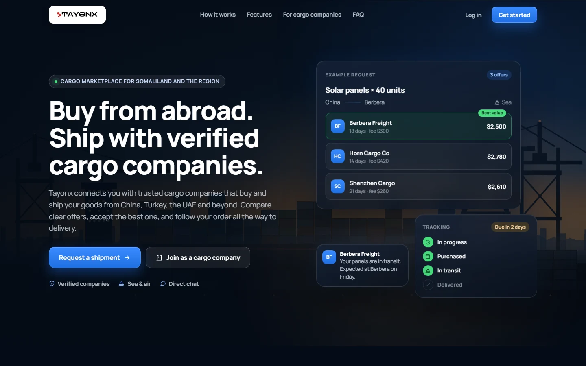

</div>

---

## Contents

- [How it works](#how-it-works)
- [Screenshots](#screenshots)
- [Features](#features)
- [Shipment lifecycle](#shipment-lifecycle)
- [Tech stack](#tech-stack)
- [Project structure](#project-structure)
- [Getting started](#getting-started)
- [User roles and pages](#user-roles-and-pages)
- [API overview](#api-overview)
- [Real-time events](#real-time-events)
- [Security and privacy](#security-and-privacy)
- [Author](#author)

---

## How it works

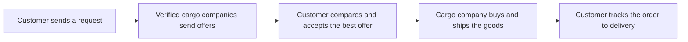

1. **Send a request.** The customer describes the product, quantity, source country and destination, by sea or air. They can send it to one verified cargo company or leave it open for providers in that country.
2. **Compare offers.** Cargo companies reply with a price per item, a delivery fee, the total and a delivery time.
3. **Accept the best one.** The other offers are declined automatically.
4. **Track to delivery.** The cargo company moves the order through *In progress → Purchased → In transit → Delivered*, and the customer is alerted when delivery is close or late.

---

## Screenshots

### Public pages

| Landing page | Sign in |
|---|---|
|  | 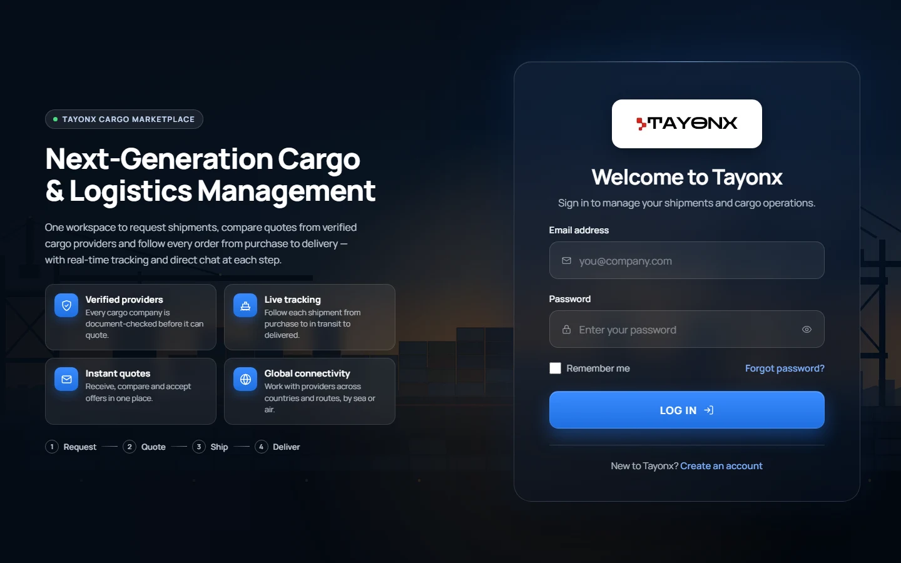 |

### Customer

| Dashboard | Offers to review |
|---|---|
| 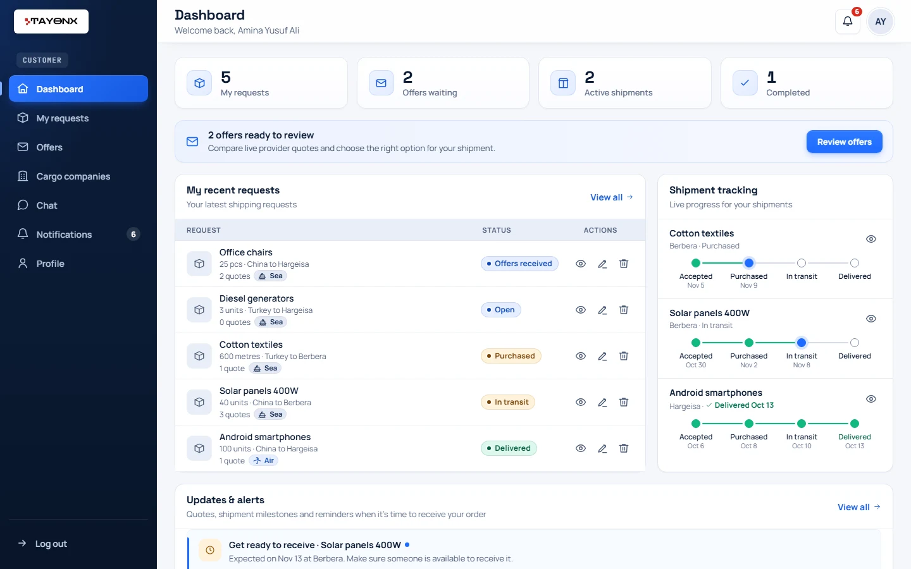 | 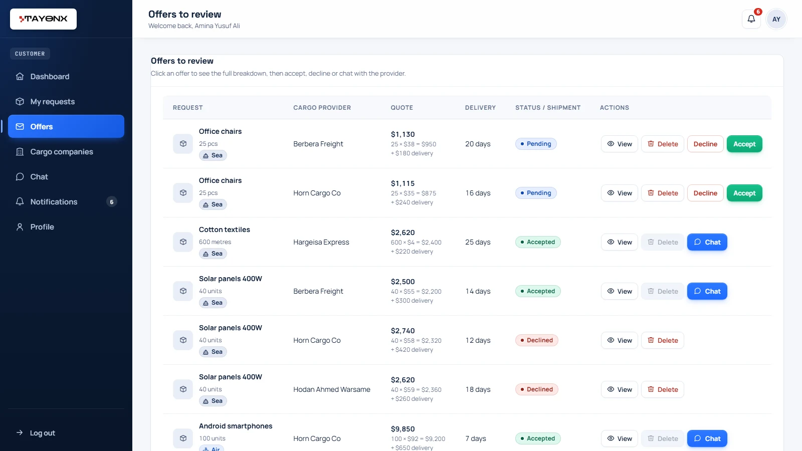 |

| Verified cargo companies | Chat |
|---|---|
| 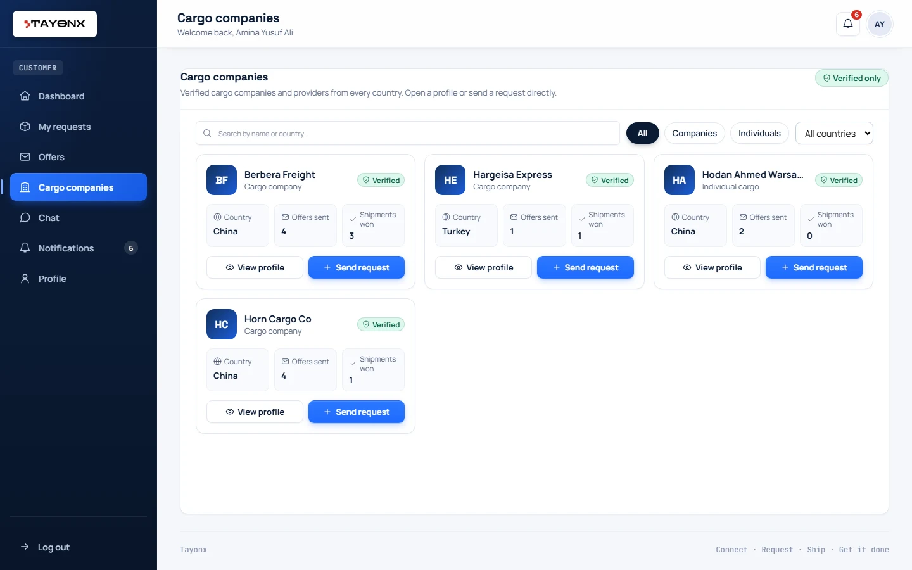 | 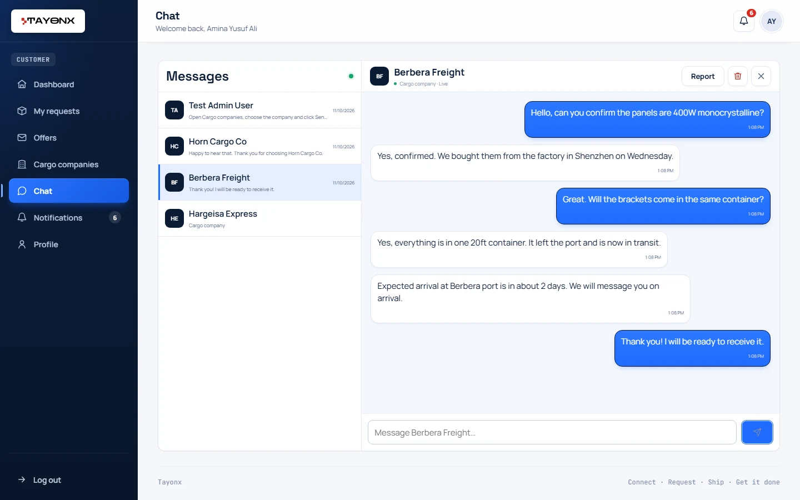 |

### Cargo company

| Dashboard | Reports & earnings |
|---|---|
| 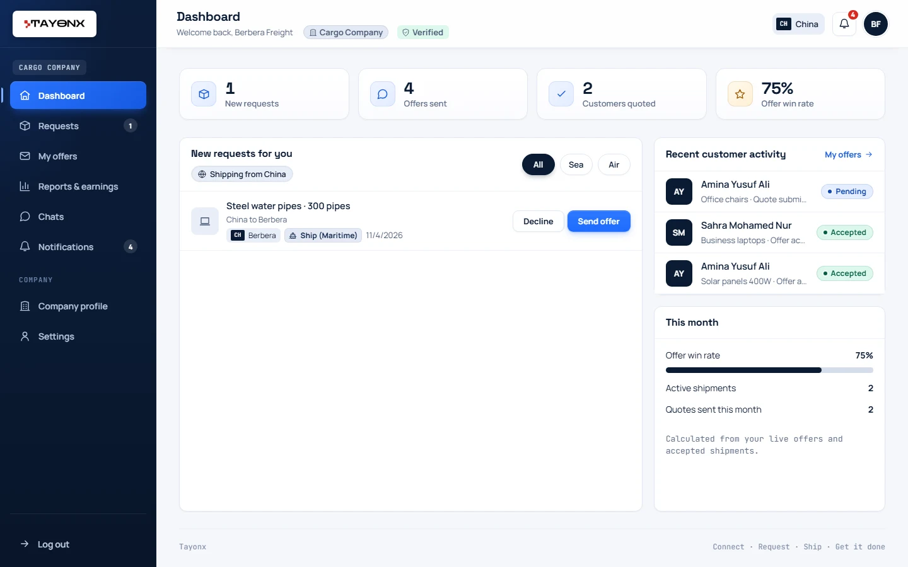 | 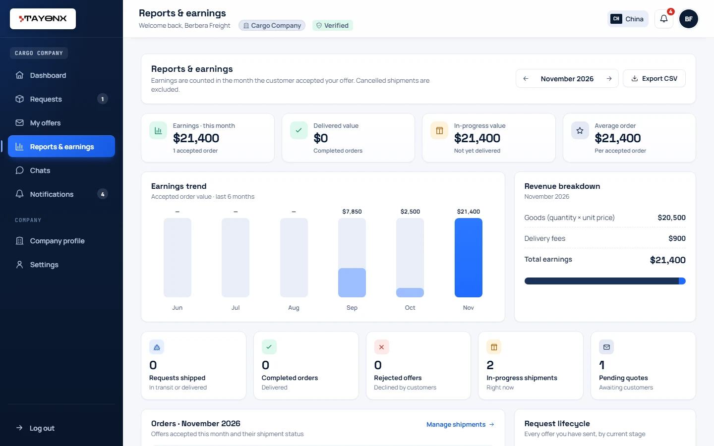 |

### Admin

| Dashboard | Analytics |
|---|---|
| 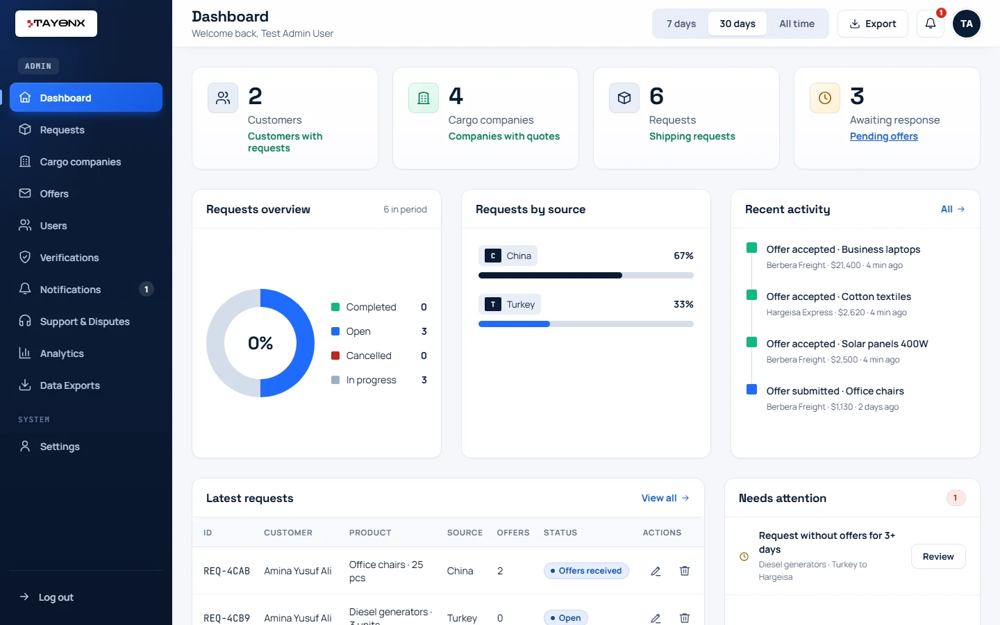 | 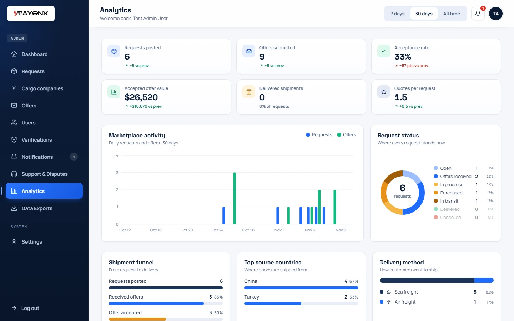 |

| Support & Disputes | Data Exports |
|---|---|
| 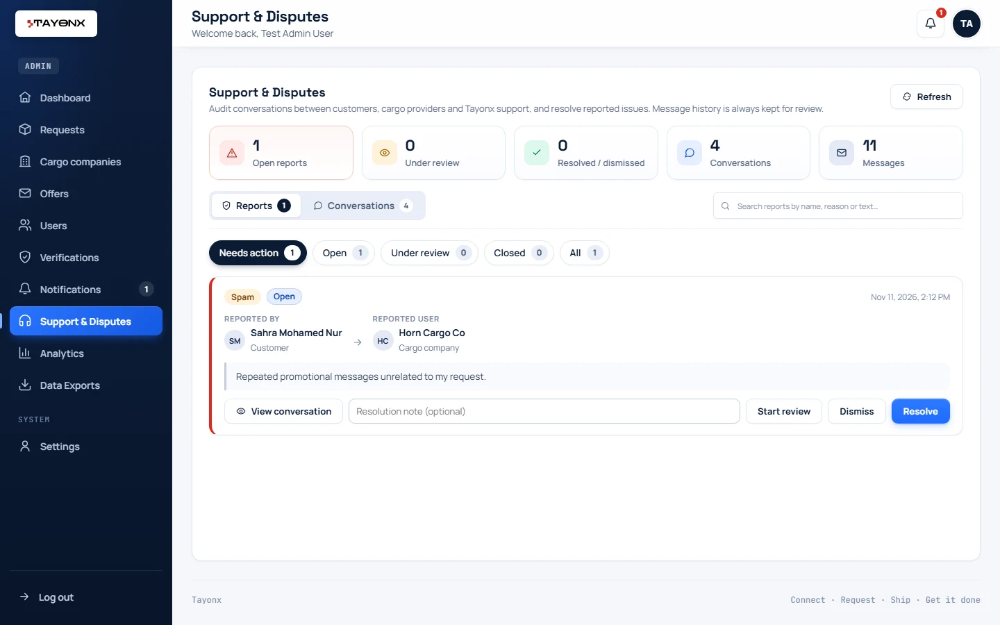 | 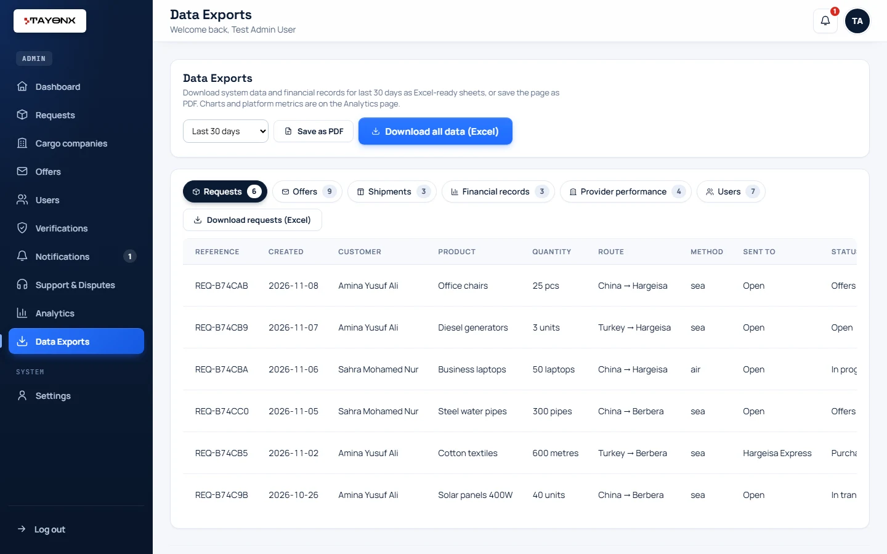 |

### On a phone

<p align="center">
  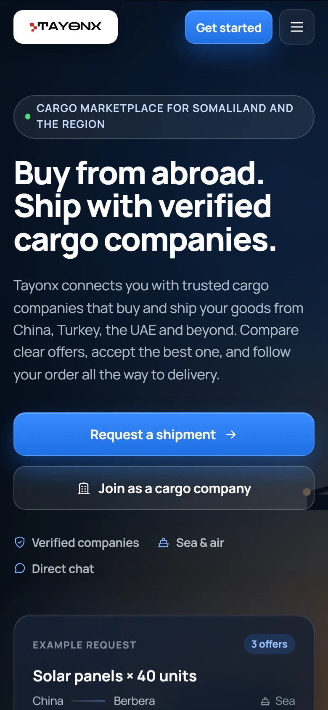
  &nbsp;&nbsp;
  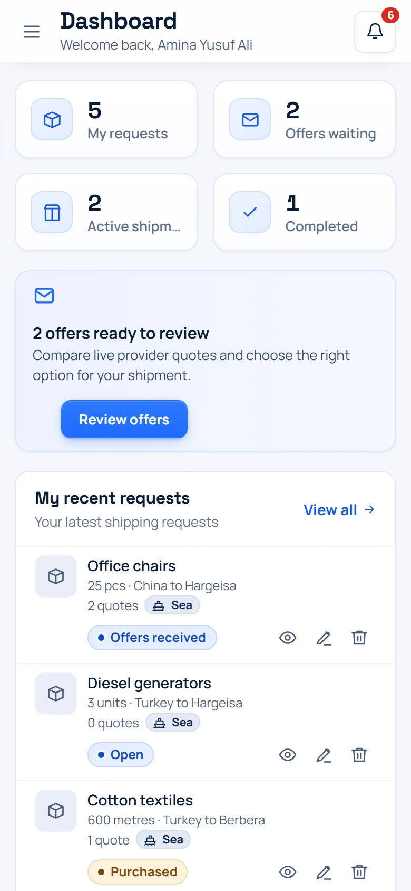
</p>

> The screenshots use demo data (example companies and customers) on a local test database.

---

## Features

### For customers
- **Company-first requests:** send a request straight to a chosen verified cargo company, or open it to providers in the source country. Product photos are optional.
- **Clear offers:** price per item, goods subtotal, delivery fee, total and delivery time on every offer, with a full details view.
- **Accept or decline** offers, reconsider a declined one, and chat with the provider from any offer.
- **Shipment tracking:** a timeline for every accepted order. Status is read-only for customers; they can only cancel before purchase.
- **Verified cargo companies directory** with public profiles, filters by type and country, and a *Send request* button.
- **Notifications:** new offers, shipment milestones, *Get ready to receive* when delivery is within two days, and overdue alerts.

### For cargo companies and individual providers
- **Verification:** companies upload a business license, ID and company legal document; individuals upload an ID. Only verified providers can send offers.
- **Requests for you:** requests sent directly to you, plus open requests from your country, filtered by sea or air.
- **Offers:** send, edit or withdraw offers. *My offers* has All, Pending, Shipments and Declined tabs.
- **Shipment updates:** move accepted orders through Purchased, In transit and Delivered.
- **Reports & earnings:** monthly earnings, a six-month trend, goods vs delivery-fee breakdown, order counts, a lifecycle summary and CSV export.
- **Notifications:** new orders, declined offers, dispatch reminders, and due-soon or overdue shipments.

### For everyone
- **Real-time chat** (Socket.IO) only between people doing business together, plus Tayonx support.
- **Close** a chat to move it to *Closed chats* with all messages kept. It re-opens with a click, when a new message arrives, or when a request or offer between you changes.
- **Delete** a chat permanently from your own account (the other person keeps their copy).
- **Report** a conversation for harassment, spam, fraud or inappropriate content.

### For admins
- **Dashboard** with users, companies, requests, pending offers, recent activity and items that need attention.
- **Requests, offers and users** management, with detailed user profiles. The last admin can't be removed.
- **Verifications:** review provider documents and approve or request changes.
- **Support & Disputes:** review reported conversations, read message logs, and start review, resolve or dismiss with a note.
- **Analytics:** charts and platform metrics for 7 days, 30 days or all time.
- **Data Exports:** requests, offers, shipments, financial records (with totals), provider performance and users as Excel-ready CSV files, or save as PDF.
- **Notifications** for overdue shipments, deliveries due within a day, requests with no offers after three days, and pending verifications.
- **Settings:** site name, support email, notifications and platform fee rate.

---

## Shipment lifecycle

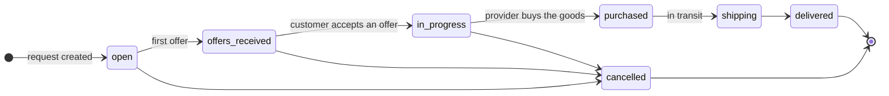

- Only the **assigned cargo company** moves a shipment forward. It can skip stages but never go back.
- **Customers** can only cancel, and only before the goods are purchased. **Admins** see the status read-only.
- Every change is stored in the request's status history, which powers the tracking timeline, due dates and reports.

---

## Tech stack

| Part | Technologies |
|---|---|
| Frontend | React 19, React Router 7, Vite 8, Socket.IO client, Oxlint |
| Backend | Node.js, Express 5, Socket.IO, JSON Web Tokens, bcryptjs, Multer (uploads) |
| Database | MongoDB with Mongoose 9 (uploaded files are stored in MongoDB too) |

---

## Project structure

```
Tayonx/
├── backend/
│   ├── constants/       # shared account rules (roles, countries)
│   ├── lib/             # offer pricing, uploads, chat thread helpers, public user views
│   ├── middleware/      # JWT authentication and role checks
│   ├── models/          # User, ShippingRequest, Chat, ChatThreadState, ChatReport,
│   │                    # VerificationRequest, UploadedFile, PlatformSettings
│   ├── routes/          # auth, requests, providers, users, chats, verification, files, admin
│   ├── socket.js        # real-time chat
│   ├── seedAdmin.js     # creates the first admin account
│   └── server.js        # Express + Socket.IO server
├── frontend/
│   └── src/
│       ├── pages/       # Landing, Login, Register, and the admin / customer / cargo dashboards
│       ├── components/  # DashboardWorkspace, Chat, CargoCompanies, NotificationsCenter,
│       │                # ProviderReports, AdminAnalytics, AdminReports, AdminChats, ...
│       ├── lib/         # API client, notifications, offer pricing, account fields
│       └── *.css        # App, theme, polish, login and landing styles
└── docs/
    └── screenshots/     # images used in this README
```

---

## Getting started

### Requirements
- [Node.js](https://nodejs.org/) 20 or newer
- A MongoDB database (local or [MongoDB Atlas](https://www.mongodb.com/atlas))

### 1. Clone the project

```bash
git clone https://github.com/apdizalam/Tayonx.git
```

```bash
cd Tayonx
```

### 2. Set up the backend

```bash
cd backend
```

```bash
npm install
```

Copy `backend/.env.example` to `backend/.env` and fill in your own values:

| Variable | What it is |
|---|---|
| `PORT` | API port (default `5000`) |
| `MONGO_URI` | Your MongoDB connection string |
| `JWT_SECRET` | A random secret, at least 32 characters |
| `FRONTEND_ORIGIN` | Frontend URL allowed by CORS (default `http://localhost:5173`) |
| `ADMIN_EMAIL` / `ADMIN_NAME` / `ADMIN_PASSWORD` | The admin account created by the seed script |

Create the admin account, then start the API:

```bash
npm run seed:admin
```

```bash
npm run dev
```

The API runs at `http://localhost:5000`.

### 3. Set up the frontend

Open a second terminal:

```bash
cd frontend
```

```bash
npm install
```

```bash
npm run dev
```

Open `http://localhost:5173`. In development, Vite forwards `/api` and `/socket.io` to the backend automatically. If your API runs somewhere else, set `VITE_API_URL`.

### Scripts

| Folder | Command | What it does |
|---|---|---|
| `backend` | `npm run dev` | Start the API with auto-reload (nodemon) |
| `backend` | `npm start` | Start the API |
| `backend` | `npm run seed:admin` | Create the admin account from `.env` |
| `frontend` | `npm run dev` | Start the Vite dev server |
| `frontend` | `npm run build` | Build for production into `frontend/dist` |
| `frontend` | `npm run lint` | Lint with Oxlint |
| `frontend` | `npm run preview` | Preview the production build |

---

## User roles and pages

| Role | Pages | Can do |
|---|---|---|
| Visitor | `/`, `/login`, `/register` | See the landing page, sign up as a customer, cargo company or individual provider |
| `customer` | `/customer/dashboard` | Send requests, review and accept offers, track shipments, chat |
| `cargo_provider` | `/cargo/dashboard` | Get verified, send offers, update shipments, view reports & earnings, chat |
| `individual_cargo` | `/cargo/dashboard` | Same as a cargo company, for individuals |
| `admin` | `/admin/dashboard` | Manage users, requests and offers, verify providers, resolve disputes, view analytics, export data, change settings |

Sign-up asks for a name (three names for customers), a phone number and a country. Customers can add a profile photo. Uploads are limited to 5 MB.

---

## API overview

| Area | Base path | Description |
|---|---|---|
| Auth | `/api/auth` | Register, log in, get the current user |
| Requests & offers | `/api/requests` | Shipping requests, offers, offer decisions and shipment status |
| Providers | `/api/providers` | Verified cargo companies directory and profiles |
| Verification | `/api/verification` | Provider document submission and admin review |
| Files | `/api/files` | Private access to uploaded photos and documents |
| Users | `/api/users` | Admin user management |
| Chats | `/api/chats` | Contacts, closed chats, message history, close, delete and report |
| Admin | `/api/admin` | Conversation audits, dispute reports and platform settings |

Every endpoint except register and login needs a `Bearer` token. See **[backend/README.md](backend/README.md)** for the full API reference.

---

## Real-time events

| Event | Direction | When |
|---|---|---|
| `send_message` | client → server | Send a chat message (acknowledged with the saved message or an error) |
| `receive_message` | server → both users | A new message was saved |
| `chat_threads_changed` | server → both users | A closed chat was restored by a request or offer update |
| `verification_submitted` / `verification_updated` | server → admins | A provider submitted documents or a review changed |
| `verification_reviewed` | server → provider | An admin approved or rejected the provider's documents |

---

## Security and privacy

- Passwords are hashed with bcrypt; sessions use signed JWTs.
- Every route checks the user's role, and shipment status changes follow strict rules.
- Verification documents and photos are served only to people allowed to see them.
- Chat is limited to people with current business together (a direct request, a pending offer or an accepted shipment) plus support admins.
- Messages are never removed from the database, so reported conversations can always be reviewed.
 abdisalan
---

## Author

**Abdisalam Mohamed**: [GitHub](https://github.com/apdizalam) · [LinkedIn](https://www.linkedin.com/in/abdisalam-m-muhumed-4b6351307) · [Email](mailto:apdizalammohameth@gmail.com)
